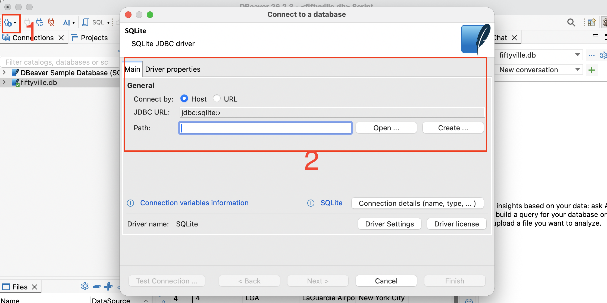
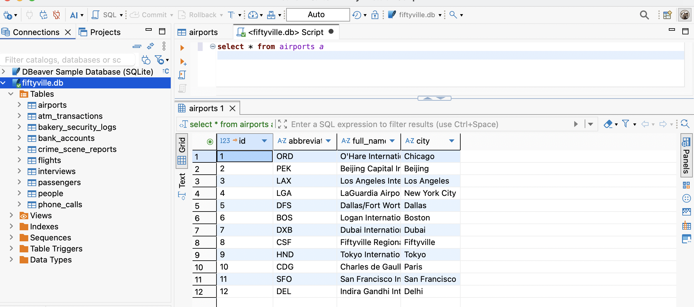

# 🦆 The Fiftyville SQL Challenge

> **The Indicium AI Duck has been stolen!**
> The town of Fiftyville needs your help to solve the mystery. Authorities believe the thief stole the duck and then, shortly afterwards, took a flight out of town with the help of an accomplice.
>
> Your mission: work out **who** the thief is, **where** they escaped to, and **who** helped them. Your only tool is SQL.

Hi everyone 👋 This is a short SQL detective game we're sharing with the team at **Indicium AI**. It's adapted from [Harvard&#39;s CS50 Problem Set 7](https://cs50.harvard.edu/x/psets/7/fiftyville/). It's a good way to practise joins, subqueries, and filtering on a messy, realistic schema, and it's more fun than a tutorial.

Expect it to take **30–90 minutes**, depending on how much SQL you write day to day.

---

## 🔎 What we know

- The theft happened on **July 28, 2025**.
- It took place on **Humphrey Street**.

Everything else is somewhere in the database.

---

## 📁 What's in the repo

| File                         | Purpose                                                                                                     |
| ---------------------------- | ----------------------------------------------------------------------------------------------------------- |
| `fiftyville/fiftyville.db` | SQLite database holding all of the town's records                                                           |
| `fiftyville/log.sql`       | **Your detective notebook.** Record every query you run here, with comments explaining your reasoning |
| `fiftyville/answers.txt`   | **Your final verdict.** Fill in the thief, the escape city, and the accomplice                        |
| `fiftyville.zip`           | The original CS50 download, kept for reference                                                              |
| `requirements.txt`         | Optional Python tools (Jupyter, JupySQL, Harlequin)                                                         |

### The database

| Table                    |  Rows | What it holds                                                      |
| ------------------------ | ----: | ------------------------------------------------------------------ |
| `crime_scene_reports`  |   301 | Police reports by date and street                                  |
| `interviews`           |   192 | Witness transcripts                                                |
| `bakery_security_logs` |   468 | Cars entering and leaving the bakery car park, with license plates |
| `atm_transactions`     | 1,332 | Withdrawals and deposits by ATM location                           |
| `bank_accounts`        |   137 | Links account numbers to people                                    |
| `phone_calls`          |   518 | Caller, receiver, and duration (in seconds)                        |
| `people`               |   200 | Name, phone number, passport number, license plate                 |
| `flights`              |    58 | Origin, destination, and departure time                            |
| `passengers`           |   359 | Passport numbers and seats on each flight                          |
| `airports`             |    12 | Airport codes and cities                                           |

Run `.schema` in the SQLite shell to see every column and foreign key.

---

## 🚀 Getting started

### 1. Clone the repo

```bash
git clone <this-repo-url>
cd sql_challenge
```

### 2. Pick how you want to query

**Option A: DBeaver (recommended for best devX)**

1. Download DBeaver here: https://dbeaver.io/download/ 
2. Open DBeaver
3. Create new connection for SQLite
4. In Path, choose the file path for `fiftyville.db`
5. Finish the connection and download any SQLite drivers needed




**Option B: the `sqlite3` CLI (no installs)**

```bash
sqlite3 fiftyville/fiftyville.db
```

```sql
sqlite> .tables
sqlite> .schema crime_scene_reports
sqlite> .mode table        -- nicer output
sqlite> SELECT * FROM airports LIMIT 5;
sqlite> .quit
```

If `sqlite3` isn't installed: `brew install sqlite` (macOS), `sudo apt install sqlite3` (Ubuntu), or `winget install SQLite.SQLite` (Windows).

**Option C: Python, Jupyter, or a terminal IDE**

```bash
python3 -m venv .venv
source .venv/bin/activate          # Windows: .venv\Scripts\activate
pip install -r requirements.txt
```

Then either:

```bash
harlequin fiftyville/fiftyville.db   # terminal SQL IDE with autocomplete
```

or start `jupyter lab` and, in a notebook:

```python
%load_ext sql
%sql sqlite:///fiftyville/fiftyville.db
```

```sql
%%sql
SELECT * FROM crime_scene_reports LIMIT 5;
```

**Option D: whatever you already use.** DataGrip, VS Code's SQLite extension, and Databricks (upload the `.db`) all work. It's a plain SQLite file.

### 3. Solve it

1. Start from what you know (the date and street) and look for the crime scene report.
2. Follow every lead. Each clue points to another table.
3. Write each query into `fiftyville/log.sql` with a comment saying **why** you ran it.
4. Narrow the suspects down until only one person is left in every list.
5. Fill in `fiftyville/answers.txt`:

```
The THIEF is: <name>
The city the thief ESCAPED TO: <city>
The ACCOMPLICE is: <name>
```

---

## 🧠 Hints (only if you're stuck)

<details>
<summary>Hint 1: Where do I start?</summary>

Query `crime_scene_reports` for the date and street. The description points you to the next table.

</details>

<details>
<summary>Hint 2: The witnesses</summary>

Read the `interviews` from the same day. Look for transcripts that mention the bakery. Each witness gives you a separate lead.

</details>

<details>
<summary>Hint 3: Connecting the dots</summary>

`people` is the hub. License plates, phone numbers, passport numbers, and (through `bank_accounts`) account numbers all lead back to it. Try `IN (subquery)` or `JOIN`s to intersect the suspect lists from each lead.

</details>

<details>
<summary>Hint 4: Watch out for…</summary>

- Times are split into `hour` and `minute` columns.
- "Less than a minute" means `duration < 60`.
- "Earliest flight tomorrow" means sorting by `hour, minute`.

</details>

---

## 🏁 Rules of the game

- **No spoilers.** Please don't post answers or solutions in shared channels. DM if you want to compare notes.
- **No AI for the solving part.** The point is to practise SQL yourself. Use AI afterwards to review your queries if you like.
- **Show your work.** A clean, commented `log.sql` matters as much as the answer.
- **Share afterwards.** Once you're done, open a branch (`solution/<your-name>`) so we can compare approaches. There's usually more than one elegant path to the answer.

### Bonus challenges 🏆

- Solve it in a **single query**.
- Solve it with **CTEs only** (`WITH ...`), no nested subqueries.
- Use the fewest queries in your log.

---

## 📚 Credits

The challenge and dataset come from [CS50&#39;s Introduction to Computer Science](https://cs50.harvard.edu/x/), Harvard University, licensed under [CC BY-NC-SA 4.0](https://creativecommons.org/licenses/by-nc-sa/4.0/). We share it here for internal learning only.

Happy sleuthing, detectives! 🕵️
